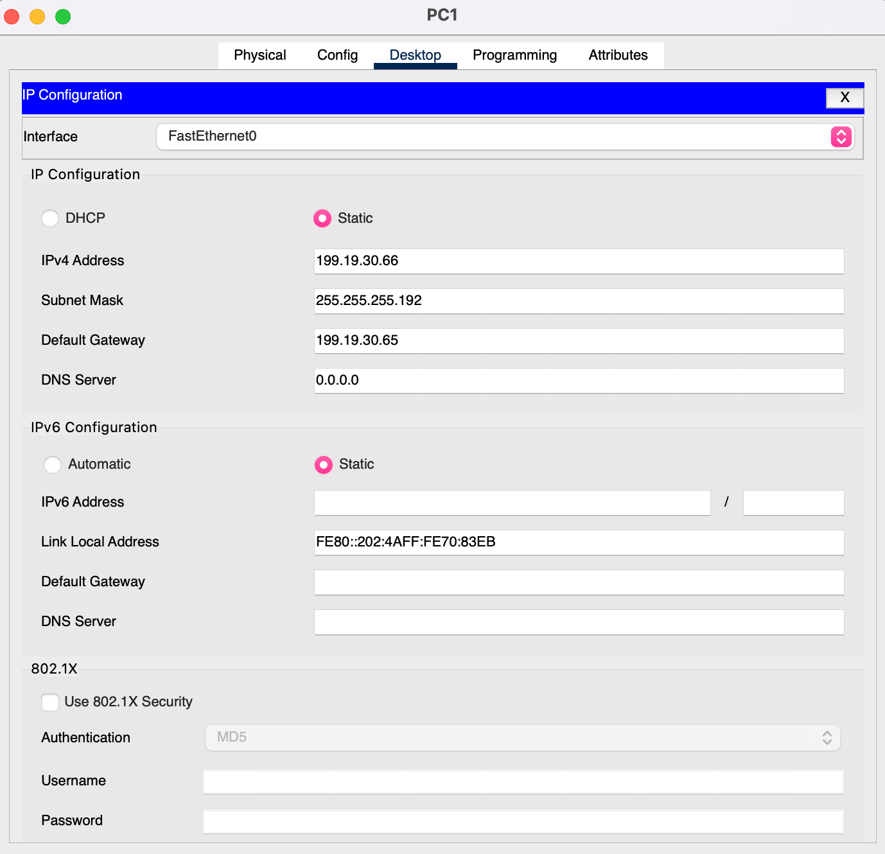
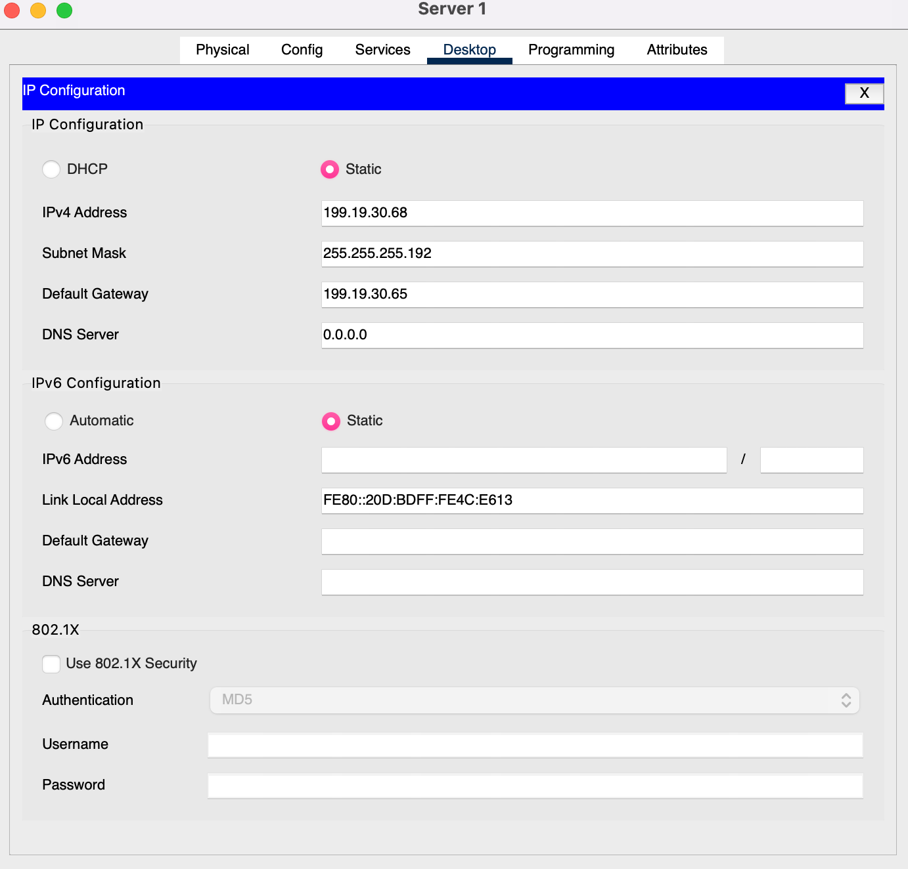
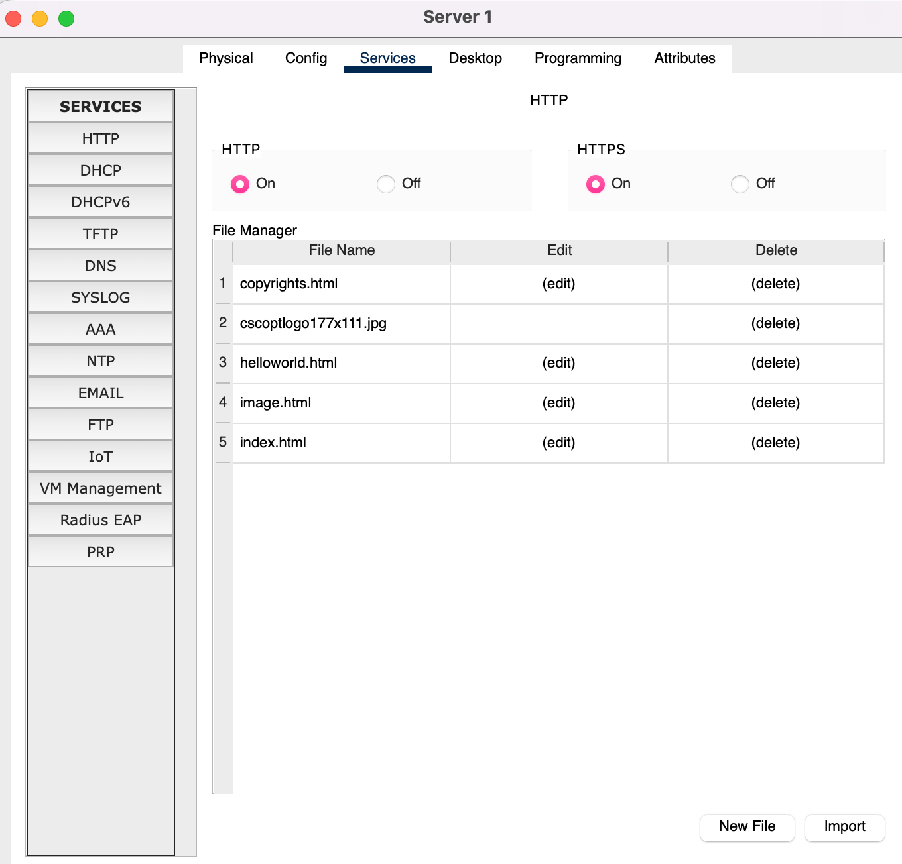
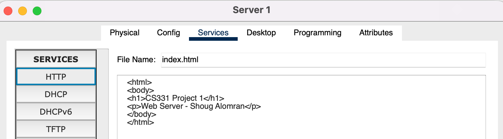

## Static addressing

| Host     | Network | IP address     | Subnet mask       | Default gateway |
| -------- | ------- | -------------- | ----------------- | --------------- |
| PC A     | A       | `199.19.30.2`  | `255.255.255.192` | `199.19.30.1`   |
| PC B     | A       | `199.19.30.3`  | `255.255.255.192` | `199.19.30.1`   |
| PC1      | B       | `199.19.30.66` | `255.255.255.192` | `199.19.30.65`  |
| PC2      | B       | `199.19.30.67` | `255.255.255.192` | `199.19.30.65`  |
| Server 1 | B       | `199.19.30.68` | `255.255.255.192` | `199.19.30.65`  |

### Network A

<div class="gallery contain" markdown>


</div>

### Network B

<div class="gallery contain" markdown>






</div>

## Web server

On Server 1, under **Services → HTTP**, I turned on **HTTP** and **HTTPS** and edited `index.html` to show my own page:

```{ .html title="index.html" }
<html>
<body>
<h1>CS331 Project 1</h1>
<p>Web Server - Shoug Alomran</p>
</body>
</html>
```

<div class="gallery contain" markdown>





</div>

The browser test from PC B is on the [Verification](verification.md#web-access-from-pc-b) page.
