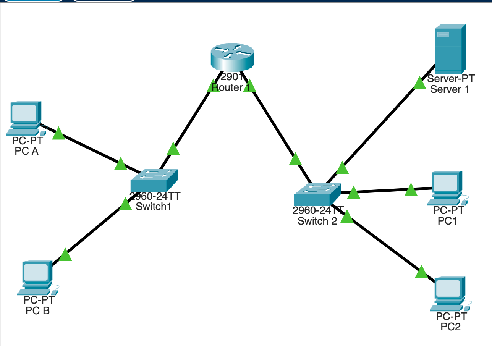

## At a glance

  

/26

Mask 255.255.255.192

  

4

Subnets, two in use

  

62

Usable hosts per subnet

  

TTL 127

Replies across one router

## Devices

| Device                | Model      | Role                                       |
| --------------------- | ---------- | ------------------------------------------ |
| R1                    | Cisco 2901 | Router: G0/0 → Network A, G0/1 → Network B |
| Switch1               | Cisco 2960 | Network A access switch                    |
| Switch 2              | Cisco 2960 | Network B access switch                    |
| PC A, PC B            | PC         | Hosts on Network A                         |
| PC1, PC2              | PC         | Hosts on Network B                         |
| Web Server (Server 1) | Server     | HTTP and HTTPS on Network B                |

## The build, step by step

  <a class="card card-link" href="topology/">
:icon-network:
<h3>Topology</h3>
Cabling, and which router port faces which LAN.
Open :icon-arrow-right:</a>
  <a class="card card-link" href="subnetting/">
:icon-grid:
<h3>Subnetting</h3>
Borrow 2 bits: four /26 subnets of 62 hosts.
Open :icon-arrow-right:</a>
  <a class="card card-link" href="router-config/">
:icon-terminal:
<h3>Router config</h3>
IOS commands on R1, then <code>show ip interface brief</code>.
Open :icon-arrow-right:</a>
  <a class="card card-link" href="end-devices/">
:icon-monitor:
<h3>End devices</h3>
Static IPs, gateways, and the custom web page.
Open :icon-arrow-right:</a>
  <a class="card card-link" href="verification/">
:icon-check:
<h3>Verification</h3>
The 100% loss incident, the fix, and the TTL=127 replies.
Open :icon-arrow-right:</a>
  <a class="card card-link" href="assets/Shoug_Alomran_Project1.pkt" download>
:icon-download:
<h3>Packet Tracer file</h3>
<code>Shoug_Alomran_Project1.pkt</code>, the submitted network.
Download :icon-arrow-right:</a>

