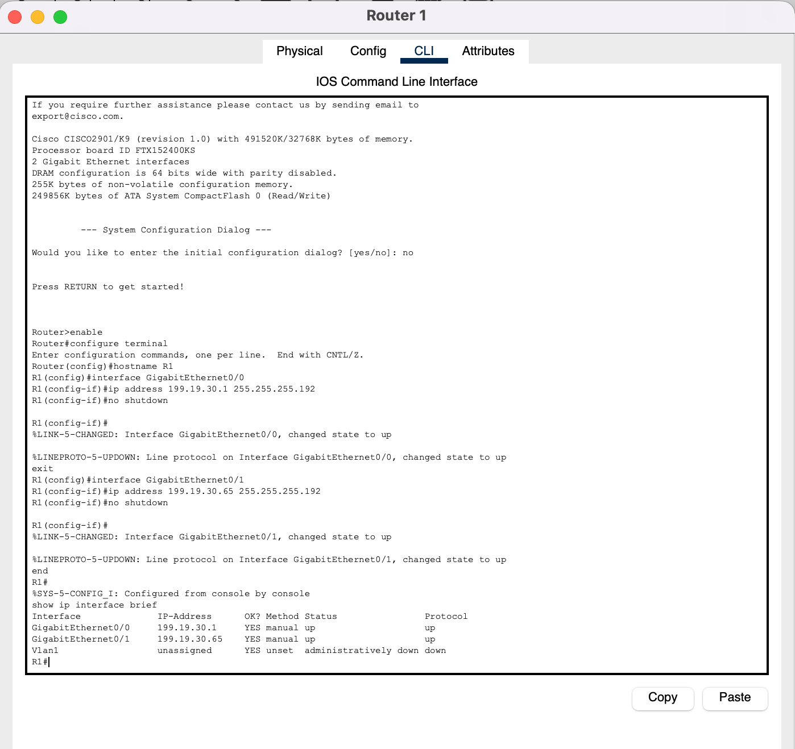
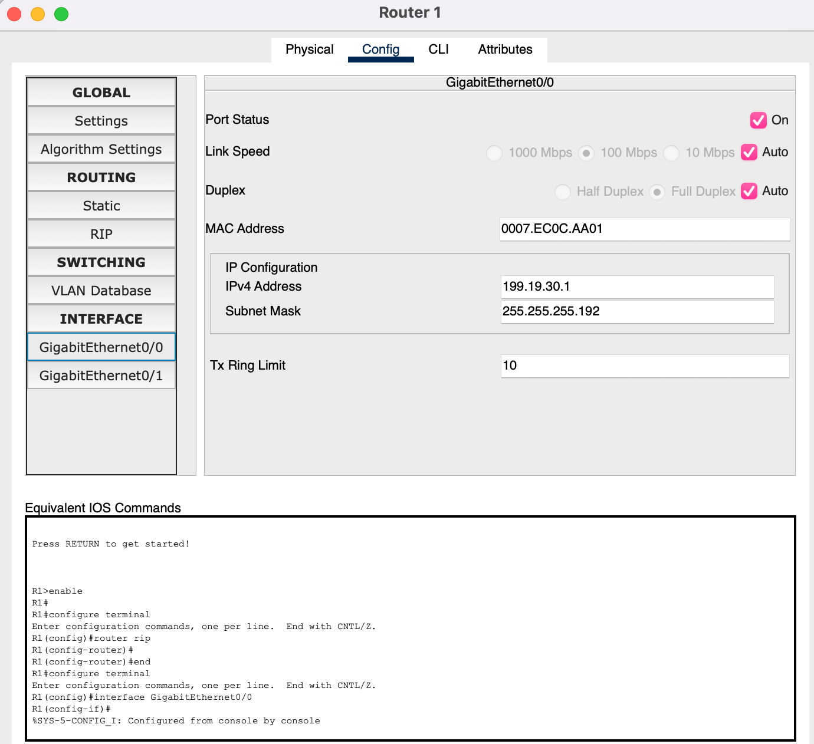
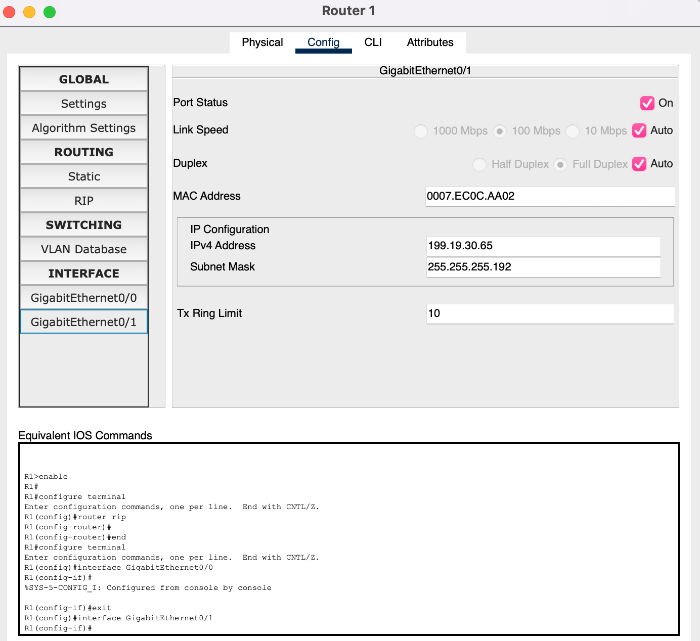
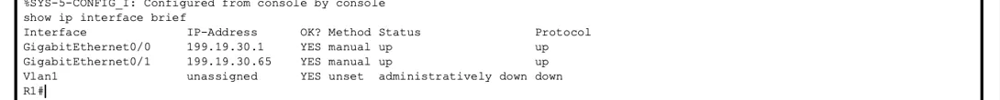

## Configuration

```{ .text .ios title="R1 · console" }
Router>enable
Router#configure terminal
Router(config)#hostname R1
R1(config)#interface GigabitEthernet0/0
R1(config-if)#ip address 199.19.30.1 255.255.255.192
R1(config-if)#no shutdown
R1(config-if)#exit
R1(config)#interface GigabitEthernet0/1
R1(config-if)#ip address 199.19.30.65 255.255.255.192
R1(config-if)#no shutdown
R1(config-if)#end
R1#
```

| Command                                  | What it does                                  |
| ---------------------------------------- | --------------------------------------------- |
| `enable`                                 | User EXEC (`>`) → privileged EXEC (`#`)       |
| `configure terminal`                     | Enter global configuration mode               |
| `hostname R1`                            | Name the router. The prompt changes at once   |
| `interface GigabitEthernet0/0`           | Select the port facing Network A              |
| `ip address 199.19.30.1 255.255.255.192` | Network A's gateway address with the /26 mask |
| `no shutdown`                            | Turn the interface on                         |
| `end`                                    | Back to privileged EXEC                       |

<div class="gallery contain single tall" markdown>



</div>

The Config tab shows the same settings per interface:

<div class="gallery contain" markdown>





</div>

## `show ip interface brief`

```{ .text .ios title="R1 · show ip interface brief" }
R1#show ip interface brief
Interface              IP-Address      OK? Method Status                Protocol
GigabitEthernet0/0     199.19.30.1     YES manual up                    up
GigabitEthernet0/1     199.19.30.65    YES manual up                    up
Vlan1                  unassigned      YES unset  administratively down down
```

<div class="gallery contain single" markdown>



</div>

<div class="grid g-2" markdown>

<div class="card" markdown>
<div class="card-icon">:icon-plug:</div>

### Status · up · Layer 1

A cable is connected and the port has not been shut down.
</div>

<div class="card" markdown>
<div class="card-icon">:icon-activity:</div>

### Protocol · up · Layer 2

The link is working at the data-link layer.
</div>

</div>

/// tip | Saving
`copy running-config startup-config` (or `write memory`) saves the configuration to NVRAM so it survives a reload. Packet Tracer also stores it inside the `.pkt` file.
///
