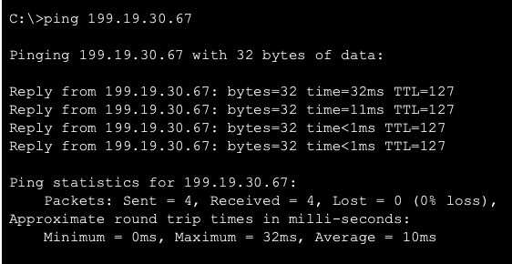
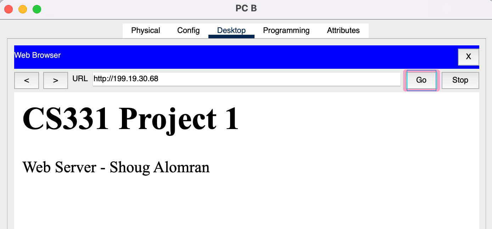

## Troubleshooting the first ping

<div class="incident" markdown>
<span class="tag">:icon-alert: Incident · PC A → PC2 · 100% loss</span>

### Both router ports were up/up, and nothing crossed.

<ol class="timeline">
  <li><span class="t">Symptom</span>The first ping from PC A to PC2 (<code>199.19.30.67</code>) failed: four timeouts, <strong>100% loss</strong>.</li>
  <li><span class="t">Narrow it down</span>I pinged PC A's own default gateway, <code>199.19.30.1</code>. That failed too. If a host can't reach its own gateway, the problem is local: addressing, cabling or the interface. Routing hasn't come into it yet.</li>
  <li class="mid"><span class="t">Check</span>The addresses matched the plan, and both router interfaces still showed up/up because each had a cable in it. Then I checked which router port each switch uplink was plugged into. <strong>The two uplinks were on swapped ports.</strong> Switch1 (Network A, gateway <code>.1</code>) was in G0/1 (<code>.65</code>), and Switch 2 was in G0/0.</li>
  <li class="mid"><span class="t">Why that breaks it</span>PC A sent ARP asking for <code>199.19.30.1</code>, but the router port on its wire was <code>199.19.30.65</code>, on the other subnet. Nothing answered, so the ping never left the LAN.</li>
  <li class="ok"><span class="t">Fix</span>Re-cabled <strong>Switch1 → G0/0</strong> and <strong>Switch 2 → G0/1</strong>.</li>
  <li class="ok"><span class="t">Result</span>PC A → PC2 succeeded. All four replies came back with <strong>TTL=127</strong>.</li>
</ol>
</div>

```{ .text .ios title="PC A · Command Prompt · before the fix" }
C:\>ping 199.19.30.67

Pinging 199.19.30.67 with 32 bytes of data:

Request timed out.
Request timed out.
Request timed out.
Request timed out.

Ping statistics for 199.19.30.67:
    Packets: Sent = 4, Received = 0, Lost = 4 (100% loss),
```

There is no screenshot of the failed run. The block above is Packet Tracer's standard output for four timeouts.

/// note | Try it yourself
The [ping lab](../index.md#ping-lab) on the home page simulates this network. Set the uplinks to **Swapped** and ping across R1 to see the same failure. A ping inside the same LAN still works, because the switch never needs the router.
///

## Ping after the fix

```{ .text .ios title="PC A · Command Prompt · after the fix" }
C:\>ping 199.19.30.67

Pinging 199.19.30.67 with 32 bytes of data:

Reply from 199.19.30.67: bytes=32 time=32ms TTL=127
Reply from 199.19.30.67: bytes=32 time=11ms TTL=127
Reply from 199.19.30.67: bytes=32 time<1ms TTL=127
Reply from 199.19.30.67: bytes=32 time<1ms TTL=127

Ping statistics for 199.19.30.67:
    Packets: Sent = 4, Received = 4, Lost = 0 (0% loss),
Approximate round trip times in milli-seconds:
    Minimum = 0ms, Maximum = 32ms, Average = 10ms
```

<div class="gallery contain single" markdown>



</div>

<div class="grid g-2" markdown>

<div class="card" markdown>
<div class="card-icon hot">:icon-router:</div>

### TTL=127 means one router hop

PC2 sends its reply with TTL 128. R1 subtracts 1 while forwarding it, so it reaches PC A with 127. One router between the hosts, as designed.
</div>

<div class="card" markdown>
<div class="card-icon">:icon-clock:</div>

### The first reply is the slowest

32 ms, then 11 ms, then under 1 ms. The first exchange waits while ARP resolves the MAC addresses: PC A learns the gateway's, and R1 learns PC2's. After that they are cached.
</div>

</div>

## Web access from PC B

From **PC B → Desktop → Web Browser** I opened `http://199.19.30.68`. The page on Server 1 loaded: **CS331 Project 1 / Web Server - Shoug Alomran**. PC B is on Network A and the server is on Network B, so the HTTP request was routed through R1. That checks every layer of the design together.

<div class="gallery contain single" markdown>



</div>

## Checklist

| Check                        | Result                                          |
| ---------------------------- | ----------------------------------------------- |
| R1 G0/0 and G0/1 up/up       | <span class="led"></span>Pass                   |
| PC A → own gateway           | <span class="led"></span>Pass, after re-cabling |
| PC A → PC2 (Network A → B)   | <span class="led"></span>Pass, 4/4, TTL=127     |
| PC B → `http://199.19.30.68` | <span class="led"></span>Pass                   |
