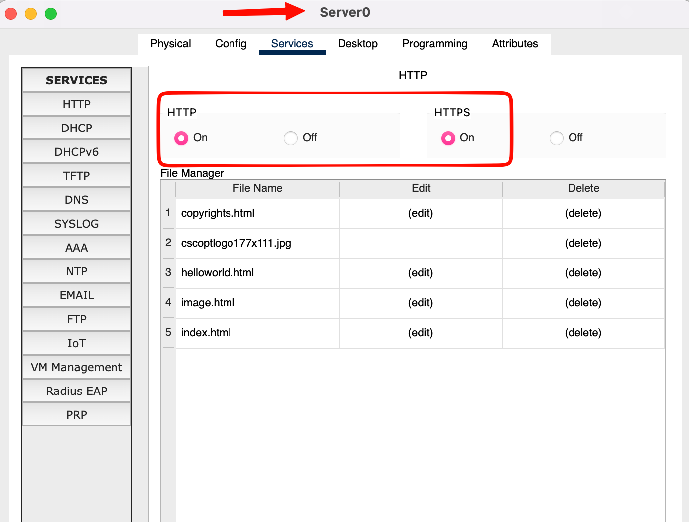
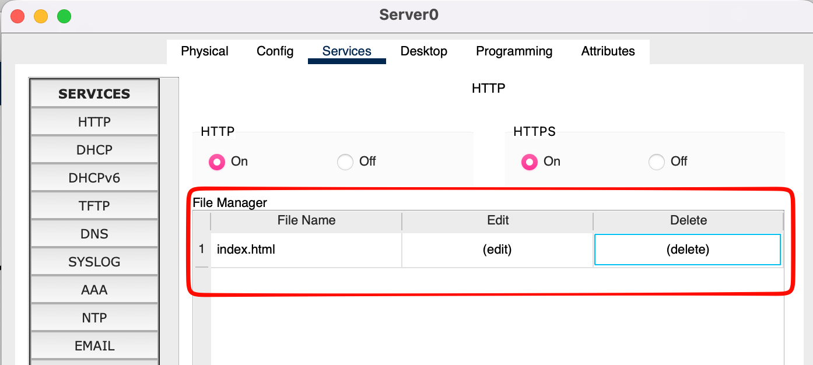
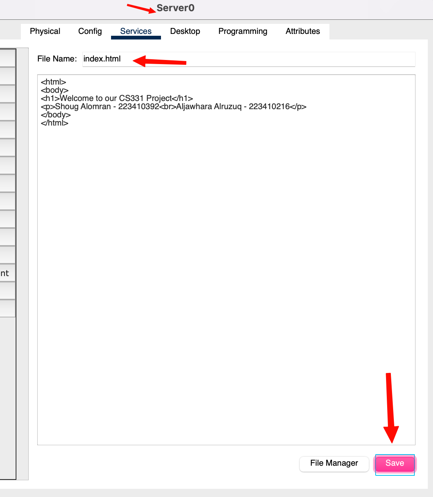

## Enabling HTTP and HTTPS

On Server0, **Services → HTTP**, both **HTTP** and **HTTPS** switched to **On**. HTTP serves the page on port 80 and HTTPS on port 443.

<div class="gallery contain single" markdown>



</div>

## Deleting the default files

Packet Tracer's server ships with a sample site. In the **File Manager** we deleted every default file except `index.html`:

| File | Action |
|---|---|
| `copyrights.html` | Deleted |
| `cscoplogo177x111.jpg` | Deleted |
| `helloworld.html` | Deleted |
| `image.html` | Deleted |
| `index.html` | **Kept and edited** |

<div class="gallery contain single" markdown>



</div>

## Customising index.html

We clicked **(edit)** next to `index.html`, replaced its content with the brief's template filled in with our names and student IDs, and clicked **Save**.

``` { .html title="index.html" }
<html>
<body>
<h1>Welcome to our CS331 Project</h1>
<p>Shoug Alomran - 223410392<br>Aljawhara Alruzuq - 223410216</p>
</body>
</html>
```

<div class="gallery contain single tall" markdown>



</div>
