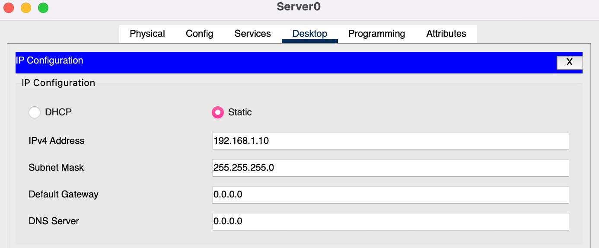
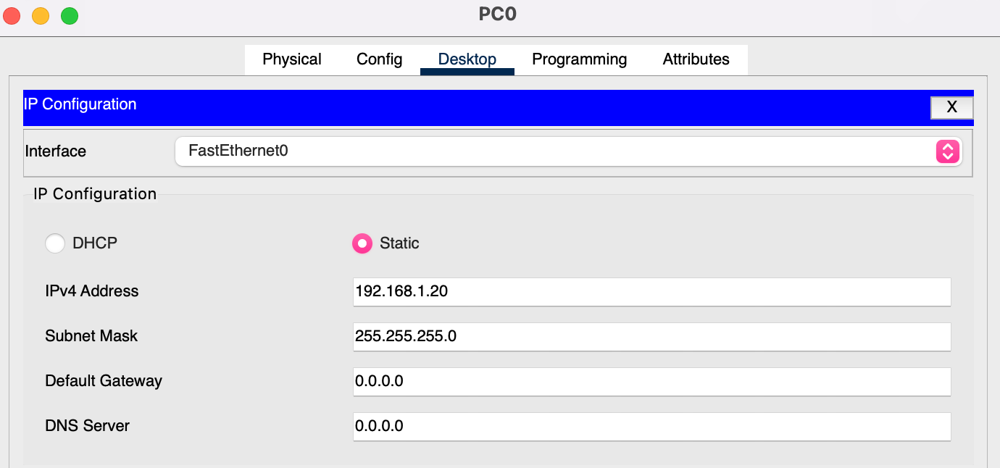

## Addressing table

| Device  | Interface     | IP address     | Subnet mask     | Default gateway |
| ------- | ------------- | -------------- | --------------- | --------------- |
| Server0 | FastEthernet0 | `192.168.1.10` | `255.255.255.0` | N/A             |
| PC0     | FastEthernet0 | `192.168.1.20` | `255.255.255.0` | N/A             |

## Web server

On Server0: **Desktop → IP Configuration → Static**, IPv4 address `192.168.1.10`, subnet mask `255.255.255.0`.

## Client PC

On PC0: the same steps with `192.168.1.20` and the same mask, which puts the PC on the server's network.

/// tip | Why no gateway?
A default gateway is only used for destinations outside the host's own subnet. With a /24 mask, `192.168.1.10` and `192.168.1.20` share the first three octets, so PC0 finds Server0's MAC with ARP and sends to it directly through the switch. Compare [Project 1](../project-1/subnetting.md), where the hosts are on different /26 subnets and every packet between them goes through R1.
///
