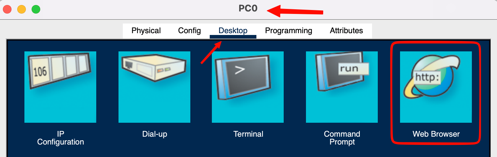
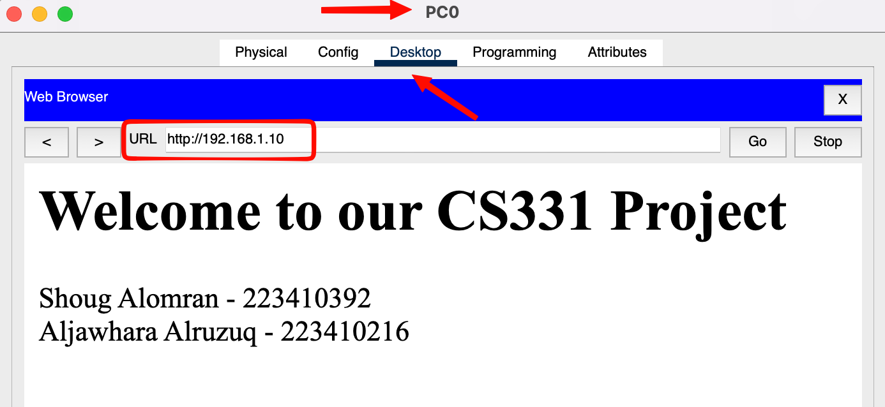

## Opening the web browser

On PC0: **Desktop → Web Browser**.

## Accessing the server by IP

In the URL field we entered `http://192.168.1.10` and clicked **Go**. Server0 answered with the custom page: **Welcome to our CS331 Project**, followed by both group members' names and student IDs.

:icon-globe:

### No DNS needed

The URL uses the IP address directly, so there is no name to resolve. That is why the brief could leave the DNS server out.

:icon-switch:

### No router needed

Both devices are in `192.168.1.0/24`. PC0 learns Server0's MAC with ARP and the switch forwards the frames directly.

:icon-send:

### HTTP end to end

The browser opens a TCP connection to port 80, sends `GET /`, and gets `index.html` back. Every layer from the cable up is working.

## Checklist

| Check                                      | Result                        |
| ------------------------------------------ | ----------------------------- |
| Static IPs on Server0 and PC0              | Pass |
| HTTP and HTTPS on                          | Pass |
| Only `index.html` left in the File Manager | Pass |
| `index.html` shows both members and IDs    | Pass |
| PC0 loads `http://192.168.1.10`            | Pass |
