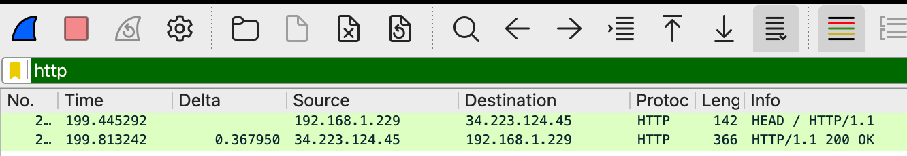
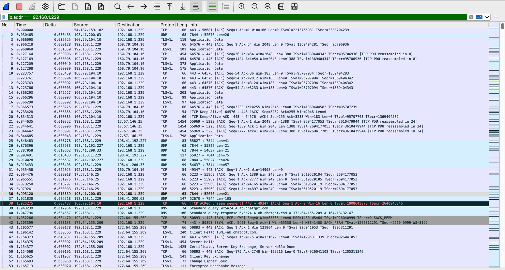
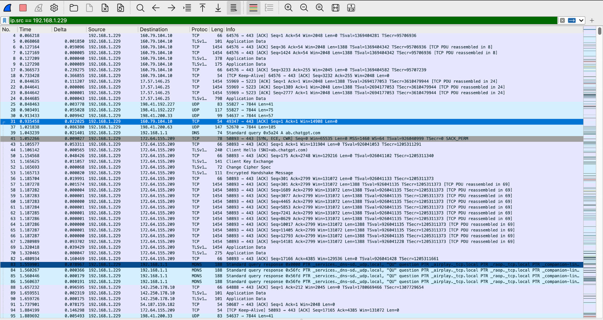
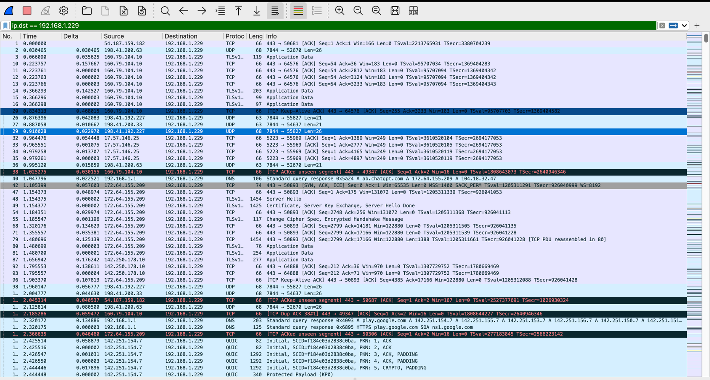
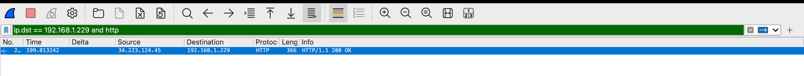
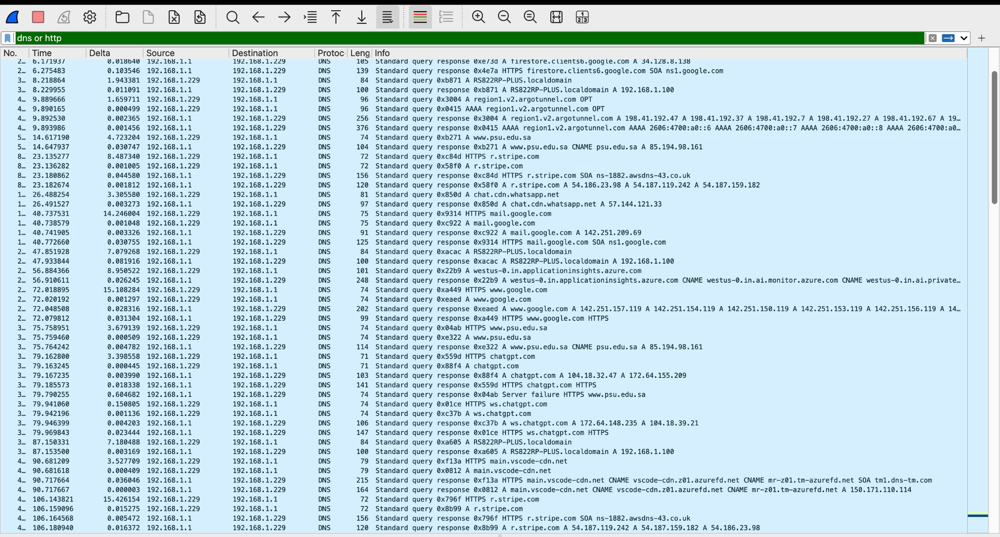
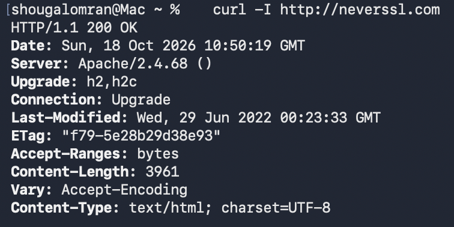
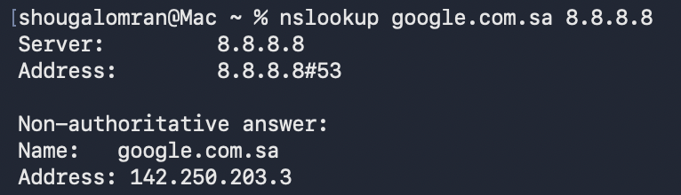

## The six filters

|   # | Filter                             | Shows                                                                  |
| --: | ---------------------------------- | ---------------------------------------------------------------------- |
|   1 | `http`                             | Only HTTP: the `HEAD /` request and the `200 OK` reply                 |
|   2 | `ip.addr == 192.168.1.229`         | Every IPv4 packet to **or** from my Mac                                |
|   3 | `ip.src == 192.168.1.229`          | Only packets my Mac **sent**                                           |
|   4 | `ip.dst == 192.168.1.229`          | Only packets my Mac **received**                                       |
|   5 | `ip.dst == 192.168.1.229 and http` | HTTP addressed to my Mac, which is the server's response               |
|   6 | `dns or http`                      | Lookups and web requests together, each lookup just before its request |

`ip.addr` matches if **either** the source or the destination equals the address. `and` keeps packets that match both conditions, and `or` keeps packets that match either one.

### `http`

<div class="gallery contain single" markdown>



</div>

### `ip.addr`, `ip.src` and `ip.dst`

<div class="gallery contain" markdown>







</div>

### `ip.dst == 192.168.1.229 and http`

<div class="gallery contain single" markdown>



</div>

### `dns or http`

<div class="gallery contain single" markdown>



</div>

## Why PSU never showed up as HTTP

The lab asks for HTTP traffic from **www.psu.edu.sa**, but that site only accepts **HTTPS**. The capture shows it clearly:

<div class="stats">
  <div class="stat"><div class="stat-value" style="color:var(--link-down)">53</div><div class="stat-label">TCP SYNs to <code>85.194.98.161:80</code></div></div>
  <div class="stat"><div class="stat-value" style="color:var(--link-down)">0</div><div class="stat-label">Replies from port 80</div></div>
  <div class="stat"><div class="stat-value" style="color:var(--link-up)">12,985</div><div class="stat-label">Packets on port 443 (TLS), both ways</div></div>
  <div class="stat"><div class="stat-value">0</div><div class="stat-label">PSU packets under the <code>http</code> filter</div></div>
</div>

Port 80 never answered, so `curl` gave up with a timeout. Everything the browser loaded came over TLS on port 443. That traffic is encrypted, so Wireshark's `http` filter has nothing to show.

To get readable HTTP I used **http://neverssl.com** (`34.223.124.45`), a site kept on plain HTTP for testing:

```{ .text .ios title="zsh · curl" }
% curl -I http://neverssl.com
HTTP/1.1 200 OK
Server: Apache/2.4.68 ()
Content-Type: text/html; charset=UTF-8
! remaining headers trimmed
```

<div class="gallery contain single" markdown>



</div>

## One name, two correct answers

`google.com.sa` was resolved twice:

| Resolver                              | Answer          | Where                                    |
| ------------------------------------- | --------------- | ---------------------------------------- |
| `8.8.8.8` (Google Public DNS)         | `142.250.203.3` | `nslookup google.com.sa 8.8.8.8`         |
| `192.168.1.1` (the router, local DNS) | `172.217.17.35` | Frames 221 and 224, just before the ping |

```{ .text .ios title="zsh · nslookup via 8.8.8.8" }
% nslookup google.com.sa 8.8.8.8
Server:		8.8.8.8
Address:	8.8.8.8#53

Non-authoritative answer:
Name:	google.com.sa
Address: 142.250.203.3
```

<div class="gallery contain single" markdown>



</div>

Both answers are correct:

<div class="grid g-3" markdown>

<div class="card" markdown>
<div class="card-icon">:icon-server:</div>

### Many front ends

Google serves the same site from many IP addresses around the world, not from one machine.
</div>

<div class="card" markdown>
<div class="card-icon">:icon-globe:</div>

### Depends on who asks

Google's DNS gives out an address near where the query seems to come from. My router and 8.8.8.8 sit in different places, so each gets a different "nearest" server.
</div>

<div class="card" markdown>
<div class="card-icon">:icon-network:</div>

### Anycast

`8.8.8.8` is one address announced from many Google sites. The query goes to whichever is closest in routing terms.
</div>

</div>

The ping used the local answer, so every ICMP packet in the capture goes to `172.217.17.35`.
