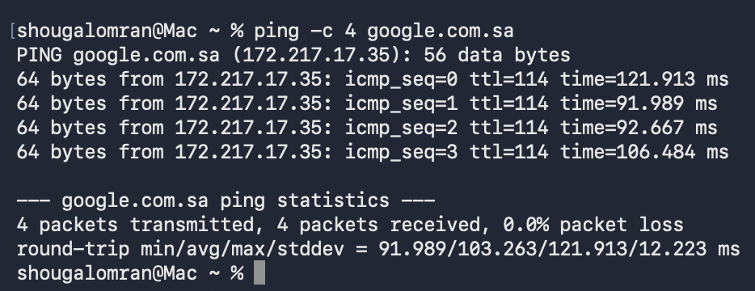
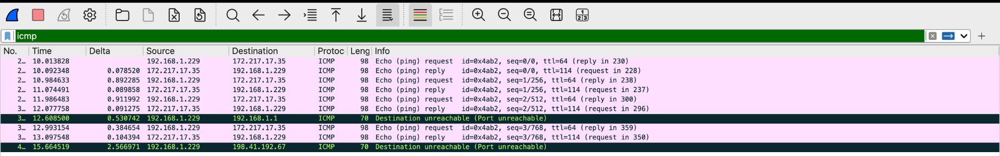
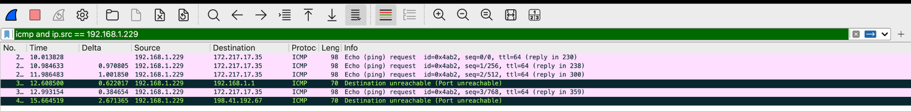
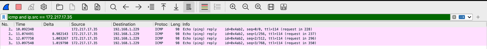
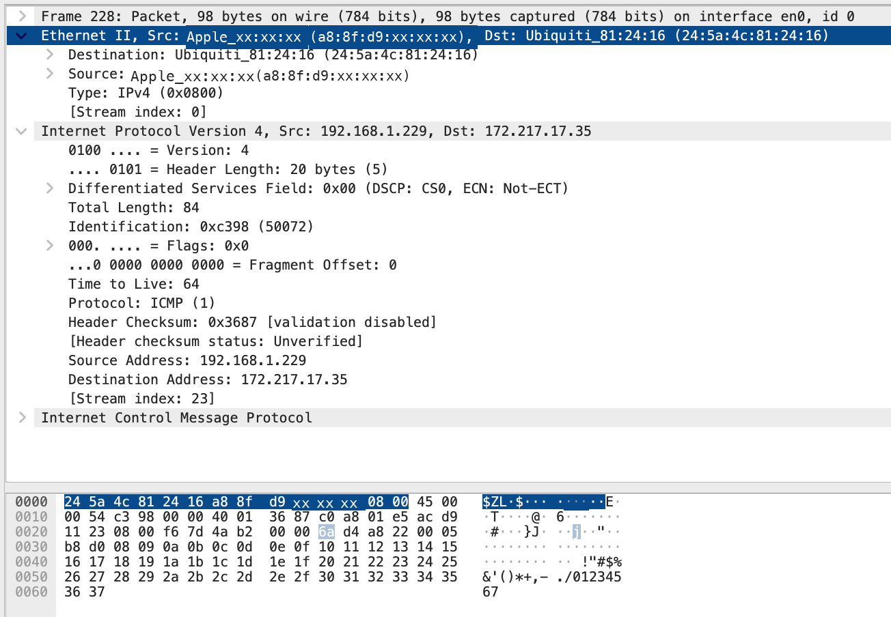
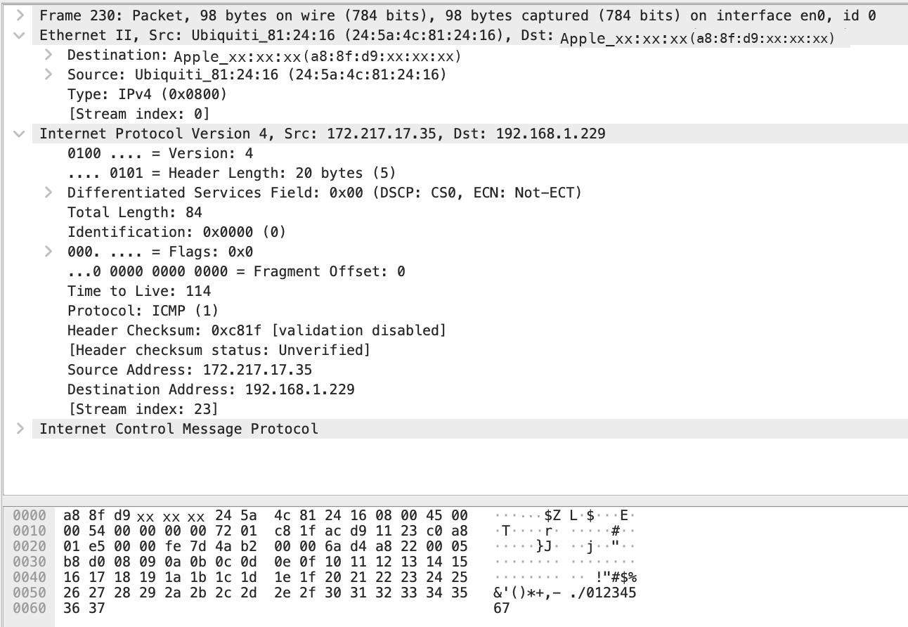

## The ping

```{ .text .ios title="zsh · ping" }
% ping -c 4 google.com.sa
PING google.com.sa (172.217.17.35): 56 data bytes
64 bytes from 172.217.17.35: icmp_seq=0 ttl=114 time=121.913 ms
64 bytes from 172.217.17.35: icmp_seq=1 ttl=114 time=91.989 ms
64 bytes from 172.217.17.35: icmp_seq=2 ttl=114 time=92.667 ms
64 bytes from 172.217.17.35: icmp_seq=3 ttl=114 time=106.484 ms

--- google.com.sa ping statistics ---
4 packets transmitted, 4 packets received, 0.0% packet loss
round-trip min/avg/max/stddev = 91.989/103.263/121.913/12.223 ms
```

<div class="gallery contain single" markdown>



</div>

## The `icmp` filter

<div class="stats">
  <div class="stat"><div class="stat-value">10</div><div class="stat-label">ICMP packets in total</div></div>
  <div class="stat"><div class="stat-value">8</div><div class="stat-label">Echo: 4 requests + 4 replies</div></div>
  <div class="stat"><div class="stat-value" style="color:var(--link-down)">2</div><div class="stat-label">Destination unreachable (port)</div></div>
  <div class="stat"><div class="stat-value">6 / 4</div><div class="stat-label">From my Mac / from Google</div></div>
</div>

Click a filter to apply it to the real frames:

<div class="panel pkt-list" data-pkt>
  <div class="pkt-filter">
    <span class="bar">:icon-filter:<span>icmp</span></span>
    <span class="count">displayed <b>10</b> / 10</span>
  </div>
  <div style="padding: 10px 14px; border-bottom: 1px solid var(--line)" class="pkt-buttons">
    <button type="button" data-f="all" aria-pressed="true">icmp</button>
    <button type="button" data-f="me" aria-pressed="false">icmp and ip.src == 192.168.1.229</button>
    <button type="button" data-f="google" aria-pressed="false">icmp and ip.src == 172.217.17.35</button>
  </div>
  <div class="pkt-table">
    <div class="pkt-row head"><span>No.</span><span>Time</span><span>Source</span><span>Destination</span><span>TTL</span><span>Info</span></div>
    <div class="pkt-row req sel" data-src="me"><span>228</span><span>10.013828</span><span>192.168.1.229</span><span>172.217.17.35</span><span>64</span><span>Echo (ping) request</span></div>
    <div class="pkt-row rep" data-src="google"><span>230</span><span>10.092348</span><span>172.217.17.35</span><span>192.168.1.229</span><span>114</span><span>Echo (ping) reply</span></div>
    <div class="pkt-row req" data-src="me"><span>237</span><span>10.984633</span><span>192.168.1.229</span><span>172.217.17.35</span><span>64</span><span>Echo (ping) request</span></div>
    <div class="pkt-row rep" data-src="google"><span>238</span><span>11.074491</span><span>172.217.17.35</span><span>192.168.1.229</span><span>114</span><span>Echo (ping) reply</span></div>
    <div class="pkt-row req" data-src="me"><span>296</span><span>11.986483</span><span>192.168.1.229</span><span>172.217.17.35</span><span>64</span><span>Echo (ping) request</span></div>
    <div class="pkt-row rep" data-src="google"><span>300</span><span>12.077758</span><span>172.217.17.35</span><span>192.168.1.229</span><span>114</span><span>Echo (ping) reply</span></div>
    <div class="pkt-row err" data-src="me"><span>321</span><span>12.608500</span><span>192.168.1.229</span><span>192.168.1.1</span><span>64</span><span>Port unreachable</span></div>
    <div class="pkt-row req" data-src="me"><span>350</span><span>12.993154</span><span>192.168.1.229</span><span>172.217.17.35</span><span>64</span><span>Echo (ping) request</span></div>
    <div class="pkt-row rep" data-src="google"><span>359</span><span>13.097548</span><span>172.217.17.35</span><span>192.168.1.229</span><span>114</span><span>Echo (ping) reply</span></div>
    <div class="pkt-row err" data-src="me"><span>419</span><span>15.664519</span><span>192.168.1.229</span><span>198.41.192.67</span><span>64</span><span>Port unreachable</span></div>
  </div>
</div>

The same three filters in Wireshark:

<div class="gallery contain" markdown>







</div>

### The two port unreachables

They are not part of the ping. My Mac sent them to say "nothing is listening on that UDP port", and each one quotes the packet it answers:

- **Frame 321** answers a DNS reply from `192.168.1.1:53` to port `40076`. It arrived after the lookup had finished and the port had closed.
- **Frame 419** answers a UDP packet from `198.41.192.67:7844`, a Cloudflare address, to a port that was also closed. Unrelated background traffic.

The `icmp` filter catches them because ICMP also carries error reports.

## Frame 228, layer by layer

Frame 228 is the first echo request with my IP as the source.

<div class="frame">
  <div class="l2"><em>Destination MAC · 6 B</em><b>24:5a:4c:81:24:16</b><span>the router, 192.168.1.1</span></div>
  <div class="l2"><em>Source MAC · 6 B</em><b>a8:8f:d9:xx:xx:xx</b><span>my MacBook</span></div>
  <div class="ty"><em>Type</em><b>0x0800</b><span>IPv4</span></div>
  <div class="l3"><em>IPv4 · ICMP echo request</em><b>192.168.1.229 → 172.217.17.35</b><span>TTL 64</span></div>
</div>

<div class="gallery contain" markdown>





</div>

### Is the destination MAC Google's?

**No.** It is the MAC of the default gateway, my router. The **IP** addresses name the two ends: my Mac and Google. The **MAC** addresses only name the two ends of the current link. Google is not on my Wi-Fi network, so my Mac cannot address a frame to it. It sends the frame to the gateway, whose MAC it learned with ARP. The router strips the Ethernet header, keeps the IP packet, and wraps it in a new frame for the next link. This repeats at every hop.

<div class="grid g-2" markdown>

<div class="card" markdown>
<div class="card-icon">:icon-switch:</div>

### MAC · Layer 2 · hop by hop

Changes on every link. In frame 228 the destination is the router, not Google.
</div>

<div class="card" markdown>
<div class="card-icon">:icon-globe:</div>

### IP · Layer 3 · end to end

Stays the same from my Mac to Google: `192.168.1.229 → 172.217.17.35` (unless NAT rewrites it).
</div>

</div>

**EtherType `0x0800`** tells the receiving network card that the payload is IPv4 and should go up to the IP layer.

## RTT: two clocks

| Measurement                | Calculation               | RTT            |
| -------------------------- | ------------------------- | -------------- |
| Wireshark, frame 228 → 230 | `10.092348 − 10.013828` s | **78.52 ms**   |
| `ping`, first reply        | as printed                | **121.913 ms** |

The tools time different things. **Wireshark** stamps each packet as it passes the network interface, so the gap between request and reply is close to the real network time. **`ping`** is an ordinary program: it reads the clock before handing the packet to the operating system and again after it is woken up with the reply. That also counts the kernel's network stack, socket buffers, and scheduling.

All four pings show where the extra time goes:

<div class="panel" style="--p1: var(--accent); --p4: var(--hot)">
  <div class="panel-head">
    <span class="panel-title">:icon-clock: round trip · wire vs ping, ms</span>
    <span class="legend"><span style="--c: var(--accent)"><i></i>Wireshark</span><span style="--c: var(--hot)"><i></i>ping</span></span>
  </div>
  <div class="panel-body">
    <div class="dumbbell">
      <div class="db-row"><div class="db-label">228 → 230<small>seq=0</small></div><div class="db-track"><span class="db-line" style="--a:14.2;--b:86.5"></span><span class="db-dot" style="--x:14.2;--c:var(--p1)"><span>78.520</span></span><span class="db-dot" style="--x:86.5;--c:var(--p4)"><span>121.913</span></span></div><div class="db-verdict bad">+43.39</div></div>
      <div class="db-row"><div class="db-label">237 → 238<small>seq=1</small></div><div class="db-track"><span class="db-line" style="--a:33.1;--b:36.6"></span><span class="db-dot" style="--x:33.1;--c:var(--p1)"><span>89.858</span></span><span class="db-dot" style="--x:36.6;--c:var(--p4)"></span></div><div class="db-verdict even">+2.13</div></div>
      <div class="db-row"><div class="db-label">296 → 300<small>seq=2</small></div><div class="db-track"><span class="db-line" style="--a:35.5;--b:37.8"></span><span class="db-dot" style="--x:35.5;--c:var(--p1)"><span>91.275</span></span><span class="db-dot" style="--x:37.8;--c:var(--p4)"></span></div><div class="db-verdict even">+1.39</div></div>
      <div class="db-row"><div class="db-label">350 → 359<small>seq=3</small></div><div class="db-track"><span class="db-line" style="--a:57.3;--b:60.8"></span><span class="db-dot" style="--x:57.3;--c:var(--p1)"><span>104.394</span></span><span class="db-dot" style="--x:60.8;--c:var(--p4)"></span></div><div class="db-verdict even">+2.09</div></div>
    </div>
  </div>
</div>

|  Ping |   Wire RTT | `ping` RTT |     Difference |
| ----: | ---------: | ---------: | -------------: |
| seq=0 |  78.520 ms | 121.913 ms | **+43.393 ms** |
| seq=1 |  89.858 ms |  91.989 ms |      +2.131 ms |
| seq=2 |  91.275 ms |  92.667 ms |      +1.392 ms |
| seq=3 | 104.394 ms | 106.484 ms |      +2.090 ms |

The overhead is about **2 ms** on the last three pings and **43 ms on the first**. The first packet pays one-time costs inside the Mac. Both numbers are right for what they measure, and Wireshark's is the better measure of the network.
