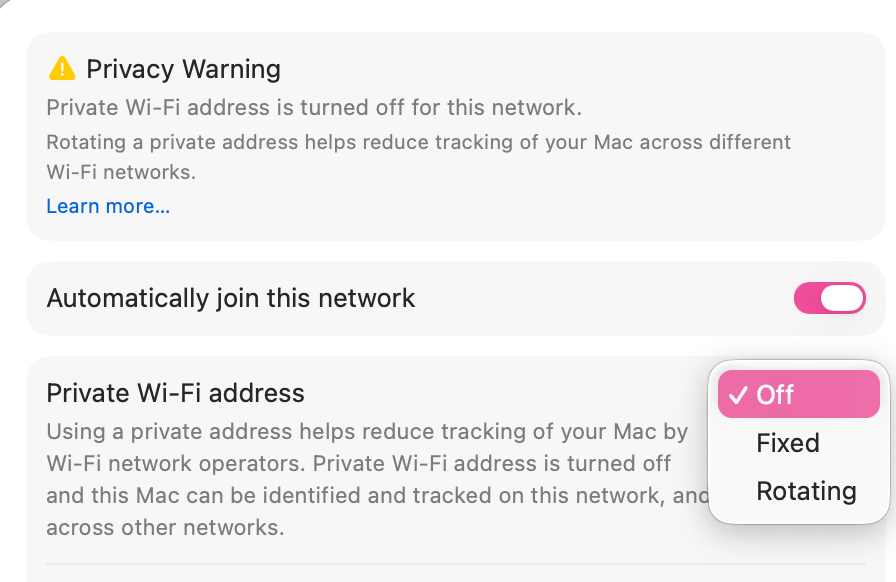
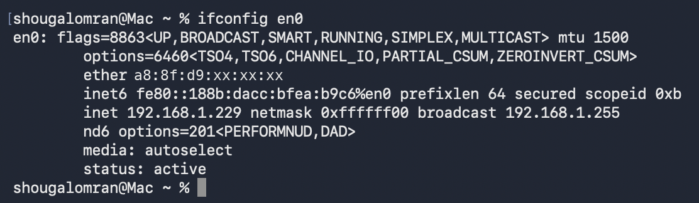
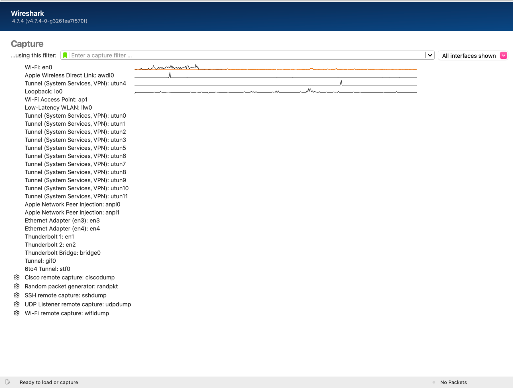
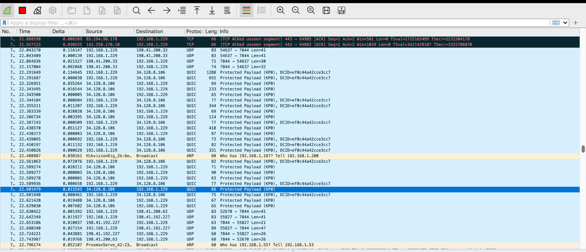

## Windows to macOS

| Lab sheet (Windows) | Used on macOS | Purpose |
|---|---|---|
| `ipconfig /all` | `ifconfig en0` | Show the MAC (`ether`) and IPv4 (`inet`) of the Wi-Fi interface |
| `ping -4 Google.com.sa` | `ping -c 4 google.com.sa` | macOS `ping` is IPv4 already. `-c 4` stops after four echoes, like Windows |
| `nslookup Google.com.sa 8.8.8.8` | `nslookup google.com.sa 8.8.8.8` | Same on both |

## Expose the hardware MAC

macOS gives each Wi-Fi network its own random MAC address by default. With that on, Wireshark would show a made-up address. I turned it off for the lab network under **System Settings → Wi-Fi → Details… → Private Wi-Fi address → Off**.

<div class="gallery contain single" markdown>



</div>

## Read the interface

``` { .text .ios title="zsh · ifconfig en0" }
% ifconfig en0
en0: flags=8863<UP,BROADCAST,SMART,RUNNING,SIMPLEX,MULTICAST> mtu 1500
	ether a8:8f:d9:xx:xx:xx
	inet 192.168.1.229 netmask 0xffffff00 broadcast 192.168.1.255
	status: active
! trimmed: options, inet6, nd6 and media lines
```

`ether` is the MAC address (Layer 2) and `inet` is the IPv4 address (Layer 3). The netmask `0xffffff00` is `255.255.255.0`, a /24.

<div class="gallery contain single" markdown>



</div>

## Start the capture

In Wireshark I selected **Wi-Fi: en0** and started capturing. While it ran, I opened www.psu.edu.sa, sent an HTTP request to neverssl.com, and later ran the ping, so every part of the lab came from live traffic.

<div class="gallery contain" markdown>





</div>
